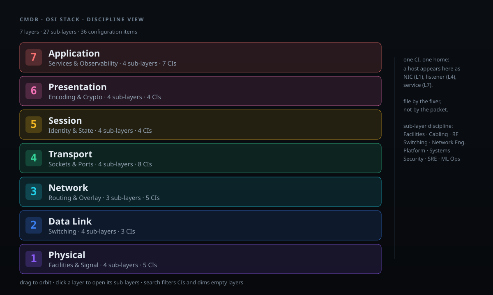

# hermes-cmdb

A configuration management database for a small lab, rendered as a **3D OSI
stack** you can orbit, click through, and search. Each OSI layer is a slab;
inside it sit its sub-layers as plates; each sub-layer lists the configuration
items filed under it, with the host, address and state.

Built as static files — no build step, no framework, three.js vendored — so it
runs from `python -m http.server`, from GitHub Pages, or from any file share.



## What is actually in it

Seed data is the real lab, not lorem ipsum: 5 hosts (two Win11 workstations, a
Debian observability host, a Proxmox node, a Linux bot host), **36 CIs across 27
sub-layers**, joined by a Tailscale tailnet.

```
L  layer              sub-layers   CIs
1  Physical                    4     5
2  Data Link                   4     3
3  Network                     3     5
4  Transport                   4     8
5  Session                     4     4
6  Presentation                4     4
7  Application                 4     7
   TOTAL                      27    36
```

## Run it

```bash
python -m http.server 8090       # or: serve.cmd on Windows
# open http://127.0.0.1:8090/
```

Opening `index.html` from the filesystem will not work: ES modules and `fetch`
need an HTTP origin. Any static server is fine (nginx, Caddy, GitHub Pages).

## Using the view

| action | result |
|---|---|
| drag | orbit · scroll to zoom · right-drag to pan |
| click a slab | selects the layer, opens its sub-layers in the panel |
| click a plate | focuses one sub-layer (its CIs stay listed) |
| `explode` | separates the layers along the Y axis |
| `spin` | stops/starts the idle auto-rotation |
| search | filters CIs by name, type, host, address, note or state; layers with no hits dim |
| host dropdown | restricts the panel to one host's CIs |

## Data model

Two files, both validated in CI-style by `scripts/validate.py`:

* **`data/osi.json`** — the model. 7 layers, each with `num`, `name`,
  `discipline`, `color`, `summary` and ≥3 `sublayers` (`id`, `name`,
  `discipline`, `detail`, `standards[]`).
* **`data/cmdb.json`** — the inventory. `hosts[]`, `cis[]`, `links[]`. Every CI
  carries `layer` (1-7) **and** `sublayer`, and the validator refuses a CI whose
  sub-layer belongs to a different layer.

Adding a configuration item is one object:

```json
{
  "id": "ci-l4-newport", "name": "Grafana :3001", "type": "listener",
  "host": "aireenpc", "layer": 4, "sublayer": "l4-ports",
  "address": "127.0.0.1:3001", "state": "up",
  "notes": "Why it exists and what breaks when it dies."
}
```

Details in [docs/SCHEMA.md](docs/SCHEMA.md); the layer rationale is in
[docs/OSI.md](docs/OSI.md).

## Verify

```bash
python scripts/validate.py     # cross-references + counts
python scripts/smoke.py        # serves the site and fetches every asset
python -m pytest -q            # same checks as tests
```

`smoke.py` is the honest test for a static viewer: it proves every file the
import map and the `fetch` calls need is actually served, and that both JSON
payloads parse.

## Design notes

* **Sub-layer is the unit of ownership.** A CI is filed where the discipline that
  would fix it lives, not where the packet lives. `l4-ports` belongs to Platform;
  `l1-power` belongs to Facilities.
* **One CI, one home.** The same physical host appears at several layers
  (NIC at L1, listener at L4, service at L7) as *different* CIs — that is what
  makes an outage traceable across layers.
* **State is first-class.** `up / degraded / planned / unknown / archived` is
  rendered, filterable, and the only field that changes on a normal day.
* **The model is data, not code.** `osi.json` is editable: rename a discipline,
  add a sub-layer, change a colour; the viewer re-reads it.

## Layout

```
index.html  app.js  style.css      the viewer (ES modules, vendored three.js)
data/osi.json  data/cmdb.json      the model and the inventory
scripts/validate.py  scripts/smoke.py
tests/test_data.py
docs/SCHEMA.md  docs/OSI.md
```

## Status

Seed data was compiled from verified lab facts (host OS versions, tailnet
addresses, listening ports, container states). It is a snapshot: no live
discovery, no credentials, no secrets. Ports and states will drift — the value
here is the structure and the rendering, and `validate.py` keeps the structure
honest.

MIT licensed.
